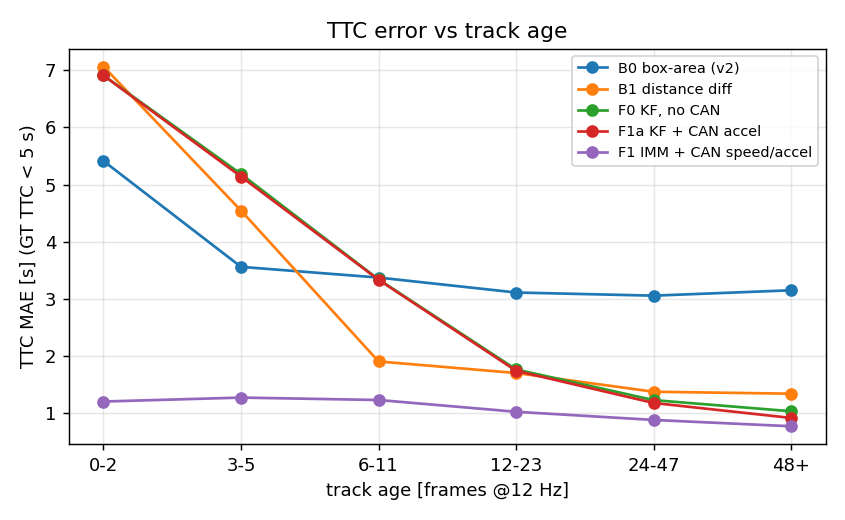
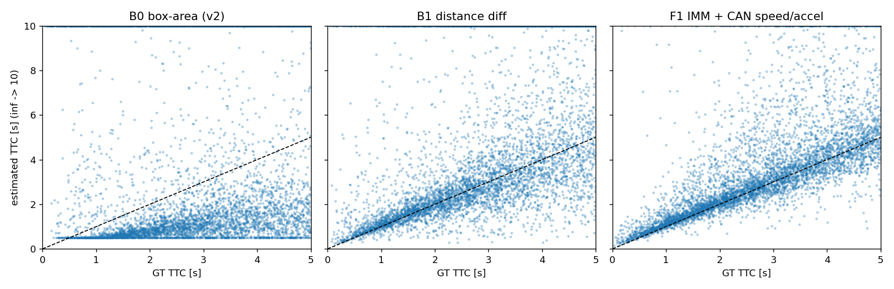
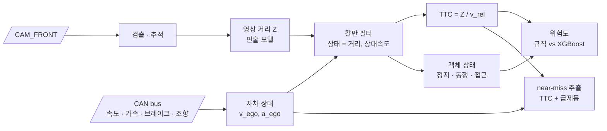

<div align="center">

# 📡 Camera–CAN Fusion Risk Assessment

**자차 상태를 아는 전방 위험 판단 — 영상 + CAN 신호 융합**


> 영상만 보는 FCW는 **내 차가 움직이는 건지, 앞차가 다가오는 건지** 구분하지 못합니다.<br/>
> CAN의 자차 속도·브레이크·조향 신호를 더해 TTC를 보정하고, 아찔했던 순간(near-miss)을 자동으로 찾아냅니다.

</div>

> [!NOTE]
> ✅ **구현 완료 (nuScenes v1.0-trainval 850 scene).** 아래 [결과](#-결과-v10-trainval-test-split) · [실행 방법](#-실행-방법) · [계획 대비 변경점](#-계획-대비-변경점)을 먼저 보세요.
> 설계 부분(문제 정의 ~ 리스크)은 계획 당시 내용을 유지하고, 바뀐 점은 변경점 절에 모았습니다.

## 🏁 결과 (v1.0-trainval, test split)

모든 수치는 scene 단위 test split(127 scene)이며, 하이퍼파라미터는 사전에 정하고 test로 고르지 않았습니다.
세부 표: [`results/`](results/).

### TTC — G1 (GT TTC < 5 s 인 매칭 객체 5,800개)

| ID | TTC 소스 | MAE [s] | 중앙값 [s] | 1 s 이내 | 흔들림 σ(ΔTTC) [s] | 오경보율 | Ż MAE [m/s] |
|:---:|---|---:|---:|---:|---:|---:|---:|
| B0 | 박스 면적 변화율 (v2) | 3.36 | 2.22 | 21.4% | 4.22 | 21.0% | – |
| B1 | 영상 거리 차분 (CAN 없음) | 2.14 | 0.74 | 56.0% | 2.04 | 2.0% | 3.83 |
| F0 | 칼만 필터, CAN 없음 | 2.21 | 0.78 | 54.8% | 0.67 | 0.5% | 2.88 |
| F1a | 칼만 + CAN 가속도 (README 초안) | 2.15 | 0.73 | 56.4% | 0.67 | 0.6% | 2.82 |
| **F1** | **IMM (등속 + 정지 가설) + CAN 속도·가속도** | **0.97** | **0.36** | **75.6%** | **0.41** | 0.7% | **1.62** |

- 오경보율 = GT TTC ≥ 10 s(또는 ∞)인데 추정 < 2 s. 흔들림 = GT TTC < 5 s keyframe 앞뒤 ±0.5 s(12 Hz)의 프레임 간 ΔTTC 표준편차.
- **CAN 가속도 입력만으로는 거의 차이가 없고(F0 → F1a: 2.21 → 2.15 s), CAN 자차 속도로 '정지 객체면 Ż = −v_ego' 가설을 넣었을 때 크게 줄어듭니다(→ 0.97 s).** 매칭 객체의 68%가 정지 객체라서입니다 (정지 객체 TTC MAE 1.84 → 0.64 s, 접근 객체 2.78 → 1.64 s).
- 트랙 시작 직후 차이가 가장 큽니다. 다른 방법은 수렴에 1–2 s가 걸리지만 F1은 첫 프레임부터 약 1 s입니다 → [`ttc_vs_age`](results/figures/ttc_vs_age_v1.0-trainval_test.png).
- val split 민감도: IMM 파라미터를 하나씩 바꿔도 TTC MAE는 0.957–0.995 s ([`sensitivity`](results/sensitivity_v1.0-trainval.md)).
- B0(v2 공식)는 프레임 수를 초로 읽은 단위 문제는 고쳤지만, 면적 ∝ 1/Z² 이라 TTC를 약 절반으로 내는 공식 자체의 편향은 그대로 둔 v2 재현입니다.

<p align="center"> </p>

### 객체 상태 — G2 (매칭 객체 16,134개, GT: 정지 68% · 동행 2% · 접근 21% · 이탈 8%)

| 방법 | 정확도 | Macro-F1 | 정지 재현율 | 동행 | 접근 | 이탈 |
|---|---:|---:|---:|---:|---:|---:|
| 영상만 (v_ego 없음 → 정지 판정 불가) | 22.1% | 0.251 | 0.0% | 52.9% | 74.0% | 60.9% |
| B1 차분 + CAN v_ego | 40.1% | 0.385 | 32.1% | 23.7% | 60.9% | 56.2% |
| F1a KF + CAN | 50.7% | 0.434 | 46.6% | 53.2% | 61.0% | 57.4% |
| **F1 IMM + CAN** | **68.3%** | **0.549** | **78.9%** | 36.5% | 46.0% | 46.8% |

F1은 정지 객체를 잘 잡는 대신 접근·이탈 재현율이 떨어집니다 (정지 가설 쪽으로 끌림).

### near-miss — G3 (850 scene 전체, 자동 기준)

| TTC 소스 | 후보 이벤트 | 자동 기준 대비 정밀도 | 재현율 (9개 중) |
|---|---:|---:|---:|
| B0 | 327 | 2.4% | 8 (88.9%) |
| B1 | 80 | 10.0% | 8 (88.9%) |
| F1 | 15 | 33.3% | 5 (55.6%) |

- 자동 기준 = 같은 규칙을 GT 3D 박스 TTC(2 Hz)에 적용한 이벤트. **850 scene에서 9개뿐**이라 수치의 불확실성이 큽니다.
- F1은 후보를 20분의 1로 줄이지만 기준 이벤트도 일부 놓칩니다.
- **사람 검수 골드셋 ([`goldset.json`](results/near_miss/goldset.json))**: F1 후보 15개 중 **11개가 실제로 위험했던 장면 → 정밀도 73.3%**.
  사람이 위험하다고 본 11개 중 7개는 자동 기준에 없었습니다(보행자 4개 포함). 자동 기준은 2 Hz GT와 '경로 안' 조건 때문에
  위험 장면을 놓치므로, 자동 기준 정밀도(33.3%)는 과소평가입니다. 검수 대상이 F1 후보뿐이라 골드셋 기준 재현율은 잴 수 없습니다.
  재평가: `python scripts/07_near_miss.py --gold results/near_miss/goldset.json` (검수 화면: [`review.html`](results/near_miss/review.html)).

### 위험도 — G4 (test, SAFE / CAUTION / DANGER = 15,949 / 158 / 27)

| ID | 모델 | Macro-F1 | DANGER 재현율 | DANGER 정밀도 |
|:---:|---|---:|---:|---:|
| R-B0 | v2 규칙 + 박스 면적 TTC | 0.080 | 96.3% | 0.5% |
| R-F1 | v2 규칙 + F1 융합 TTC (`ttc_weight`만 교체) | 0.107 | 96.3% | 0.7% |
| **F2** | **XGBoost, F1 특징 + CAN** | **0.442** | 59.3% | 5.7% |
| A1 | F2 − CAN 특징 | 0.443 | 66.7% | 7.0% |
| A2 | CAN 없는 필터(F0) 특징, CAN 특징 없음 | 0.410 | 55.6% | 5.8% |

- v2 규칙은 크기·화면 중앙 위주라 test 객체의 대부분을 CAUTION/DANGER로 올립니다. TTC 소스를 바꿔도 이 구조적 문제는 남습니다.
- **CAN의 기여는 특징(v_ego · yaw rate · 브레이크)이 아니라 필터를 통해 들어옵니다**: A1 ≈ F2, A2 < A1.
- SHAP(DANGER): `x_lat` 1.21 ≫ `ttc` 0.61 > `z` 0.38 > `v_ego` 0.30 > `v_rel` 0.21 > `yaw_rate` 0.14 > `brake_on` 0.01 → [`shap_danger`](results/figures/shap_danger_v1.0-trainval.png).
- DANGER는 test에 27개뿐이라 재현율 한 칸이 3.7%p 입니다.

### 데이터 · 정렬

- CAN `pose` 신호는 카메라 ego_pose 속도보다 **+0.08 s 늦게** 찍힙니다 (주행 scene 723개 중앙값, IQR 0.05–0.12 s). 이만큼 당겨 정렬합니다 → [`align`](results/align_v1.0-trainval.md).
- CAN 없는 scene 15개 (devkit blacklist). 이 scene에서 F1은 정지 가설 없이 동작합니다.
- 40 m 이내 GT(40% 이상 보임) 중 검출과 매칭된 비율 65.5% — TTC 지표는 매칭된 객체에서만 잽니다.

## ▶️ 실행 방법

```bash
uv venv --python 3.10 .venv && uv pip install --python .venv/bin/python -r requirements.txt
.venv/bin/python -m pytest -q tests          # 단위 테스트 25개
scripts/run_all.sh v1.0-mini                 # 파이프라인 확인 (10 scene, 수 분)
scripts/run_all.sh v1.0-trainval             # 전체 (검출이 RTX 5060 Ti 에서 약 40분)
```

nuScenes 경로는 [`configs/default.yaml`](configs/default.yaml)의 `data.dataroot` (기본 `~/data/nuscenes`, `can_bus/` 포함).

| 단계 | 스크립트 | 산출물 |
|---|---|---|
| 1 | `01_build_index.py` · `01b_align_check.py` | 프레임·GT 표, CAN 정렬, 정렬 검증 |
| 2 | `02_detect.py` | YOLO11l 검출 캐시 (12 Hz CAM_FRONT 198k 프레임) |
| 3 | `03_tracks.py` | 추적 + 거리 측정 + GT 매칭 |
| 4 | `04_calibrate.py` | 거리 단서별 bias·σ (train split만) |
| 5 | `05_fuse.py` | B0 · B1 · F0 · F1a · F1 추정, 객체 상태 |
| 6 | `06_eval_ttc.py` · `06b_sensitivity.py` | TTC · 상태 지표, 민감도 |
| 7 | `07_near_miss.py` | 후보, 자동 기준 평가, 검수 페이지 |
| 8 | `08_risk.py` | 규칙 vs XGBoost, SHAP, 위험도 벡터 (`cache/<ver>/risk_vectors.parquet`) |

## 🔀 계획 대비 변경점

| 계획 | 구현 | 이유 |
|---|---|---|
| v2 검출(Canny·컨투어) + LK 추적 | COCO 사전학습 YOLO11l + IoU(헝가리안) 추적, 모든 실험이 같은 검출 공유 | 비교 대상은 TTC 추정 방법이므로 검출 잡음을 고정 |
| 거리 = 핀홀 높이 | 핀홀 높이 + 지면 접촉 두 단서, bias·σ를 train에서 보정해 칼만 R 로 사용 | 단서별 오차 9.5% / 12.9%, 결합 9.1% |
| F1 = 칼만 + CAN 가속도 입력 | **IMM: 등속 모델 + 정지 객체 모델(Ż = −v_ego 의사 측정)**, 사전 Ż₀ = −v_ego. 초안은 F1a로 남김 | 가속도 입력만으로는 개선 없음 (2.21 → 2.15 s) |
| B0 · B1 · F1 · F2 · A1 | + F0(칼만, CAN 없음), F1a, A2 | 칼만 효과와 CAN 효과를 분리 |
| near-miss: 브레이크 ON | **주행 중 브레이크 onset** 또는 감속 < −3 m/s², 좌우 경계에 잘린 박스 제외 | 정차 중엔 브레이크가 계속 ON (mini scene-0553: 98%) |
| — | 측정 없이 0.5 s 이상 예측만 하면 추정 무효 | 잘린 박스가 Z < 0, TTC 0 을 만들었음 |
| 라벨: GT TTC 등급 | GT TTC + 진행 경로(\|x\| < 2 m): DANGER < 2 s, CAUTION < 4 s | 경로 밖 주차 차량까지 위험으로 세지 않도록 |
| v2 규칙 그대로 | 특징점 점수(10%)는 0, 차선 검출 대신 \|x\| < 1.75 m | 모든 TTC 소스에 동일 적용 |

**남은 일**: near-miss 재현율을 잴 수 있는 넓은 골드셋(B0·B1 후보 포함 검수), 근거리에서 박스 하단이 잘린 객체의 거리 추정(현재는 추정 없음), DANGER 표본이 적은 위험도 평가의 신뢰구간.

---

## 📌 문제 정의

FCW v2의 TTC는 **바운딩 박스 면적 변화율**로 계산합니다. 그래서 세 가지 문제가 있습니다.

1. 박스 크기가 흔들리면 TTC가 크게 흔들립니다 (v2 위험 장면 상위 12개가 모두 하한값 0.5 s).
2. 자차 속도를 모르기 때문에 **정지 장애물과 같은 속도로 달리는 앞차를 구분하지 못합니다.**
3. 운전자가 실제로 위험을 느꼈는지(급제동 등)와 연결되지 않습니다.

## 🎯 목표

| # | 목표 |
|:---:|---|
| G1 | 칼만 필터로 영상 거리와 CAN 자차 속도를 융합해 **상대 속도 기반 TTC** 추정 |
| G2 | 객체의 절대 속도로 **정지 / 동행 / 접근** 상태 분류 |
| G3 | TTC와 급제동 신호를 결합한 **near-miss 이벤트 자동 추출** |
| G4 | 규칙 기반 위험도와 학습 기반 위험도(XGBoost + SHAP) 비교 |

---

## 🔗 기반 수업과 저장소

| 수업 / 프로젝트 | 가져올 것 | 저장소 |
|---|---|---|
| 산업 컴퓨터비전 | 검출, LK 추적, 핀홀 거리, 위험도 공식 | [monocular-forward-collision-warning](https://github.com/cbnu-yhjeon/monocular-forward-collision-warning) |
| 차량 CAN 이상탐지 | CAN 신호 전처리, 시간 정렬, 시계열 특징 (`delta_t`) | [PROJECT-CAN-Anomaly-Detection](https://github.com/cbnu-yhjeon/PROJECT-CAN-Anomaly-Detection) |
| 연구: 적응형 카메라 뷰 | nuScenes + CAN 로더, radial TTC 정의, scene 단위 분할, 골드셋 평가 방식 | [Adaptive-Camera-View-Selection-System](https://github.com/cbnu-yhjeon/Adaptive-Camera-View-Selection-System) |
| 자전거 수요 예측 | 트리 모델 학습과 SHAP 해석 파이프라인 | [PROJECT-Bicyle-Demand-Forecasting](https://github.com/cbnu-yhjeon/PROJECT-Bicyle-Demand-Forecasting) |

---

## 🧭 접근 방법



### 1. 시간 정렬
카메라 프레임 타임스탬프에 가장 가까운 CAN 메시지를 맞추고, 필요하면 선형 보간합니다. 사용할 메시지는 nuScenes devkit `can_bus`의 `pose`, `vehicle_monitor`, `steeranglefeedback`, `ms_imu`입니다. CAN이 빠진 scene은 블랙리스트로 관리합니다.

### 2. 칼만 필터 융합
객체마다 상태 `x = [Z, Ż]`를 두고, 측정값은 영상 거리 `Z`, 입력은 CAN 자차 가속도입니다.

```
상대 속도      v_rel  = −Ż                  (다가오면 양수)
객체 절대 속도  v_obj  ≈ v_ego + Ż           (진행 방향 성분)
TTC            = Z / max(v_rel, ε)         (v_rel ≤ 0 이면 TTC = ∞)
객체 상태       |v_obj| < 1 m/s → 정지,  |Ż| < 0.5 m/s → 동행,  그 외 접근/이탈   (임계값은 초안)
```

### 3. near-miss 이벤트 (초안 정의)
`min TTC < 1.5 s` 이면서 1초 안에 `브레이크 ON` 또는 `감속 < −3 m/s²`가 함께 나타나면 이벤트 후보로 봅니다. 후보는 사람이 검수해 골드셋을 만듭니다.

### 4. 위험도 모델
- **규칙 기반:** v2 공식에서 `ttc_weight`를 융합 TTC로 교체
- **학습 기반:** 특징 `[Z, v_rel, TTC, 횡방향 거리, v_ego, yaw rate, 브레이크]`, 라벨은 GT 3D 박스로 계산한 TTC 등급. XGBoost로 학습하고 SHAP으로 해석합니다.

---

## 🗂️ 데이터

| 데이터 | 용도 | 비고 |
|---|---|---|
| [nuScenes](https://www.nuscenes.org/) `v1.0-mini` | 파이프라인 확인 | 10 scenes |
| nuScenes `v1.0-trainval` + `can_bus` | 학습 · 평가 | 3D GT 박스로 TTC 정답 계산 |

> nuScenes는 **CC BY-NC-SA 4.0**(비상업, 계정 등록 필요)입니다. 연구 저장소에서 쓰는 scene 분할(`scene_split_v1.json`)을 그대로 써서 누수를 막습니다.

---

## 🧪 실험 설계

| ID | TTC 소스 | 위험도 | 목적 |
|:---:|---|---|---|
| B0 | 박스 면적 변화율 (v2) | v2 규칙 | 기준선 |
| B1 | 영상 거리 차분 (CAN 없음) | v2 규칙 | 칼만 필터 효과만 확인 |
| F1 | 칼만 융합 (영상 + CAN) | v2 규칙 | G1 |
| F2 | 칼만 융합 | XGBoost | G4 |
| A1 | F2에서 CAN 특징 제거 | XGBoost | CAN 기여도 (ablation) |

### 지표

| 영역 | 지표 |
|---|---|
| TTC | GT TTC 대비 MAE (TTC < 5 s 구간), 프레임 간 흔들림(표준편차) |
| 객체 상태 | 정지 / 동행 / 접근 분류 정확도 (GT 속도 기준) |
| 위험도 | Macro-F1, DANGER 재현율 |
| 이벤트 | 골드셋 기준 near-miss 정밀도 · 재현율 |

---

## 🗓️ 마일스톤

| 주차 | 내용 | 산출물 |
|:---:|---|---|
| 1 | nuScenes · CAN 로더, 시간 정렬 | 정렬 검증 그래프 |
| 2 | GT TTC 계산, B0 · B1 | 기준선 결과 |
| 3 | 칼만 필터 융합 | F1 결과, TTC 흔들림 비교 |
| 4 | 객체 상태 분류, near-miss 후보 추출 | 이벤트 후보 목록 |
| 5 | 골드셋 검수, XGBoost + SHAP | F2 · A1 결과 |
| 6 | 정리, 연구 저장소에 위험도 벡터 제공 | 최종 보고서 |

## 📁 디렉토리 구조

```
Camera-CAN-Fusion-Risk/
├── configs/
├── scripts/            01–08 단계 스크립트, run_all.sh
├── src/
│   ├── data/           nuScenes 색인 · CAN 로더 · 시간 정렬 · 분할
│   ├── vision/         검출 · 추적 · 거리(핀홀 높이, 지면 접촉)
│   ├── fusion/         kalman.py (KF, IMM) · estimators.py (B0–F1) · motion_state.py
│   ├── risk/           rule_based.py (v2) · labels.py (GT) · learned.py (XGBoost + SHAP)
│   ├── events/         near_miss.py
│   └── eval/           공통 평가 유틸
├── tests/              단위 테스트
├── splits/             연구 저장소와 같은 scene 분할
├── results/            지표(md/json) · 그림 · near-miss 후보와 검수 페이지
└── README.md
```

## ⚠️ 리스크와 대응

| 리스크 | 대응 |
|---|---|
| CAN 메시지마다 주기가 다르고 일부 scene은 CAN이 없음 | 메시지별 보간, 결손 scene 블랙리스트 |
| near-miss 이벤트가 드물어 평가 표본이 작음 | trainval 전체에서 후보를 넓게 뽑고 사람이 검수 |
| 규칙으로 만든 라벨로 규칙을 평가하는 순환 문제 | 주 지표는 GT 3D 박스 기반 TTC와 사람이 검수한 골드셋 |

## 📚 참고 자료

- H. Caesar et al., *nuScenes: A multimodal dataset for autonomous driving*, CVPR 2020
- [nuscenes-devkit CAN bus expansion](https://github.com/nutonomy/nuscenes-devkit)
- R. E. Kalman, *A New Approach to Linear Filtering and Prediction Problems*, 1960
- S. Lundberg, S.-I. Lee, *A Unified Approach to Interpreting Model Predictions* (SHAP), NeurIPS 2017
