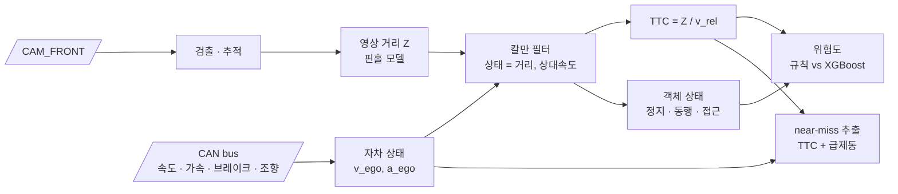

<div align="center">

# 📡 Camera–CAN Fusion Risk Assessment

**자차 상태를 아는 전방 위험 판단 — 영상 + CAN 신호 융합**


> 영상만 보는 FCW는 **내 차가 움직이는 건지, 앞차가 다가오는 건지** 구분하지 못합니다.<br/>
> CAN의 자차 속도·브레이크·조향 신호를 더해 TTC를 보정하고, 아찔했던 순간(near-miss)을 자동으로 찾아냅니다.

</div>

> [!NOTE]
> 🚧 **계획 단계입니다.** 아직 코드가 없고, 이 README는 프로젝트 설계서입니다.

---

## 📌 문제 정의

FCW v2의 TTC는 **바운딩 박스 면적 변화율**로 계산합니다. 그래서 세 가지 문제가 있습니다.

1. 박스 크기가 흔들리면 TTC가 크게 흔들립니다 (v2 위험 장면 상위 12개가 모두 하한값 0.5 s).
2. 자차 속도를 모르기 때문에 **정지 장애물과 같은 속도로 달리는 앞차를 구분하지 못합니다.**
3. 운전자가 실제로 위험을 느꼈는지(급제동 등)와 연결되지 않습니다.

## 🎯 목표

| # | 목표 |
|:---:|---|
| G1 | 칼만 필터로 영상 거리와 CAN 자차 속도를 융합해 **상대 속도 기반 TTC** 추정 |
| G2 | 객체의 절대 속도로 **정지 / 동행 / 접근** 상태 분류 |
| G3 | TTC와 급제동 신호를 결합한 **near-miss 이벤트 자동 추출** |
| G4 | 규칙 기반 위험도와 학습 기반 위험도(XGBoost + SHAP) 비교 |

---

## 🔗 기반 수업과 저장소

| 수업 / 프로젝트 | 가져올 것 | 저장소 |
|---|---|---|
| 산업 컴퓨터비전 | 검출, LK 추적, 핀홀 거리, 위험도 공식 | [monocular-forward-collision-warning](https://github.com/cbnu-yhjeon/monocular-forward-collision-warning) |
| 차량 CAN 이상탐지 | CAN 신호 전처리, 시간 정렬, 시계열 특징 (`delta_t`) | [PROJECT-CAN-Anomaly-Detection](https://github.com/cbnu-yhjeon/PROJECT-CAN-Anomaly-Detection) |
| 연구: 적응형 카메라 뷰 | nuScenes + CAN 로더, radial TTC 정의, scene 단위 분할, 골드셋 평가 방식 | [Adaptive-Camera-View-Selection-System](https://github.com/cbnu-yhjeon/Adaptive-Camera-View-Selection-System) |
| 자전거 수요 예측 | 트리 모델 학습과 SHAP 해석 파이프라인 | [PROJECT-Bicyle-Demand-Forecasting](https://github.com/cbnu-yhjeon/PROJECT-Bicyle-Demand-Forecasting) |

---

## 🧭 접근 방법



### 1. 시간 정렬
카메라 프레임 타임스탬프에 가장 가까운 CAN 메시지를 맞추고, 필요하면 선형 보간합니다. 사용할 메시지는 nuScenes devkit `can_bus`의 `pose`, `vehicle_monitor`, `steeranglefeedback`, `ms_imu`입니다. CAN이 빠진 scene은 블랙리스트로 관리합니다.

### 2. 칼만 필터 융합
객체마다 상태 `x = [Z, Ż]`를 두고, 측정값은 영상 거리 `Z`, 입력은 CAN 자차 가속도입니다.

```
상대 속도      v_rel  = −Ż                  (다가오면 양수)
객체 절대 속도  v_obj  ≈ v_ego + Ż           (진행 방향 성분)
TTC            = Z / max(v_rel, ε)         (v_rel ≤ 0 이면 TTC = ∞)
객체 상태       |v_obj| < 1 m/s → 정지,  |Ż| < 0.5 m/s → 동행,  그 외 접근/이탈   (임계값은 초안)
```

### 3. near-miss 이벤트 (초안 정의)
`min TTC < 1.5 s` 이면서 1초 안에 `브레이크 ON` 또는 `감속 < −3 m/s²`가 함께 나타나면 이벤트 후보로 봅니다. 후보는 사람이 검수해 골드셋을 만듭니다.

### 4. 위험도 모델
- **규칙 기반:** v2 공식에서 `ttc_weight`를 융합 TTC로 교체
- **학습 기반:** 특징 `[Z, v_rel, TTC, 횡방향 거리, v_ego, yaw rate, 브레이크]`, 라벨은 GT 3D 박스로 계산한 TTC 등급. XGBoost로 학습하고 SHAP으로 해석합니다.

---

## 🗂️ 데이터

| 데이터 | 용도 | 비고 |
|---|---|---|
| [nuScenes](https://www.nuscenes.org/) `v1.0-mini` | 파이프라인 확인 | 10 scenes |
| nuScenes `v1.0-trainval` + `can_bus` | 학습 · 평가 | 3D GT 박스로 TTC 정답 계산 |

> nuScenes는 **CC BY-NC-SA 4.0**(비상업, 계정 등록 필요)입니다. 연구 저장소에서 쓰는 scene 분할(`scene_split_v1.json`)을 그대로 써서 누수를 막습니다.

---

## 🧪 실험 설계

| ID | TTC 소스 | 위험도 | 목적 |
|:---:|---|---|---|
| B0 | 박스 면적 변화율 (v2) | v2 규칙 | 기준선 |
| B1 | 영상 거리 차분 (CAN 없음) | v2 규칙 | 칼만 필터 효과만 확인 |
| F1 | 칼만 융합 (영상 + CAN) | v2 규칙 | G1 |
| F2 | 칼만 융합 | XGBoost | G4 |
| A1 | F2에서 CAN 특징 제거 | XGBoost | CAN 기여도 (ablation) |

### 지표

| 영역 | 지표 |
|---|---|
| TTC | GT TTC 대비 MAE (TTC < 5 s 구간), 프레임 간 흔들림(표준편차) |
| 객체 상태 | 정지 / 동행 / 접근 분류 정확도 (GT 속도 기준) |
| 위험도 | Macro-F1, DANGER 재현율 |
| 이벤트 | 골드셋 기준 near-miss 정밀도 · 재현율 |

---

## 🗓️ 마일스톤

| 주차 | 내용 | 산출물 |
|:---:|---|---|
| 1 | nuScenes · CAN 로더, 시간 정렬 | 정렬 검증 그래프 |
| 2 | GT TTC 계산, B0 · B1 | 기준선 결과 |
| 3 | 칼만 필터 융합 | F1 결과, TTC 흔들림 비교 |
| 4 | 객체 상태 분류, near-miss 후보 추출 | 이벤트 후보 목록 |
| 5 | 골드셋 검수, XGBoost + SHAP | F2 · A1 결과 |
| 6 | 정리, 연구 저장소에 위험도 벡터 제공 | 최종 보고서 |

## 📁 디렉토리 구조 (계획)

```
Camera-CAN-Fusion-Risk/
├── configs/
├── src/
│   ├── data/           nuScenes · CAN 로더, 시간 정렬
│   ├── vision/         검출 · 추적 · 핀홀 거리
│   ├── fusion/         kalman.py · motion_state.py
│   ├── risk/           rule_based.py · learned.py (XGBoost + SHAP)
│   └── events/         near_miss.py
├── splits/             연구 저장소와 같은 scene 분할
├── results/
└── README.md
```

## ⚠️ 리스크와 대응

| 리스크 | 대응 |
|---|---|
| CAN 메시지마다 주기가 다르고 일부 scene은 CAN이 없음 | 메시지별 보간, 결손 scene 블랙리스트 |
| near-miss 이벤트가 드물어 평가 표본이 작음 | trainval 전체에서 후보를 넓게 뽑고 사람이 검수 |
| 규칙으로 만든 라벨로 규칙을 평가하는 순환 문제 | 주 지표는 GT 3D 박스 기반 TTC와 사람이 검수한 골드셋 |

## 📚 참고 자료

- H. Caesar et al., *nuScenes: A multimodal dataset for autonomous driving*, CVPR 2020
- [nuscenes-devkit CAN bus expansion](https://github.com/nutonomy/nuscenes-devkit)
- R. E. Kalman, *A New Approach to Linear Filtering and Prediction Problems*, 1960
- S. Lundberg, S.-I. Lee, *A Unified Approach to Interpreting Model Predictions* (SHAP), NeurIPS 2017
